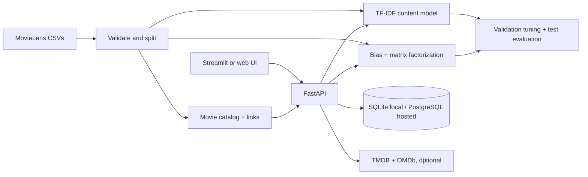

<div align="center">

# 🎬 CineMatch AI

### Discover the next movie that feels like *your* kind of story.

An explainable movie discovery and recommendation system combining content similarity, collaborative filtering, and a validation-tuned hybrid ranker — wrapped in a cinematic dark interface.

[](https://www.python.org/)
[](https://fastapi.tiangolo.com/)
[](https://github.com/Priyanshuraj0909/Movie-content-recommendation-system/actions/workflows/ci.yml)
[](https://cinematch-king-09.vercel.app)

<br />

[Open CineMatch](https://cinematch-king-09.vercel.app) · [API docs](https://cinematch-king-09.vercel.app/api/docs) · [Architecture](docs/ARCHITECTURE.md) · [Model card](docs/MODEL_CARD.md)

</div>

---

## Project at a glance

CineMatch AI is a portfolio-ready movie recommendation project built around a reproducible MovieLens pipeline. It includes a responsive browser app deployed on Vercel, a local Streamlit interface, a typed FastAPI backend, offline ranking evaluation, and optional read-only public movie ratings from TMDB and OMDb.

| | Status |
|---|---|
| Production web app | [cinematch-king-09.vercel.app](https://cinematch-king-09.vercel.app) |
| Production API health | [9,742 movies loaded](https://cinematch-king-09.vercel.app/api/health) |
| Dataset snapshot | 9,742 movies · 100,836 ratings · 610 users |
| Recommendation methods | TF-IDF content similarity · regularized biases · matrix factorization · hybrid ranking |
| External ratings | TMDB and OMDb service implemented; provider credentials are not currently configured in Vercel, so public numeric scores are unavailable there |
| Project status | Deployed; production write verification for locally submitted profile ratings is still pending |

> MovieLens provides titles, genres, user tags, and community interactions. This project does not treat those tags as plot summaries and does not invent posters, cast, trailers, or ratings.

## What you can do

- Search the MovieLens catalog by title and explore genre-filtered results.
- Find similar movies using title, genre, and aggregated user-tag text.
- Save a half-star rating to a local profile and get personalized recommendations.
- Use the popularity fallback for a profile with no positive saved ratings.
- Keep a browser-local watchlist in the deployed web app.
- See optional IMDb and TMDB community ratings, vote counts, and source links when the server has provider credentials and a valid movie match.
- Run the same FastAPI recommendation API with either the local Streamlit UI or the deployed browser UI.

### Interfaces

| Interface | How to open it | Notes |
|---|---|---|
| Deployed web app | [Open CineMatch](https://cinematch-king-09.vercel.app) | Responsive HTML/CSS/JavaScript frontend with same-origin `/api` requests |
| Local Streamlit app | `streamlit run frontend/app.py` | Run beside the local FastAPI server; includes Discover, For you, and Similar films views |
| FastAPI docs | `http://127.0.0.1:8000/api/docs` | Interactive local API documentation |

## Recommendation system

### Content-based similarity

The content model builds TF-IDF features from each movie's title, genres, and aggregated MovieLens tags. It ranks candidates using cosine similarity, omits the seed and excluded movies, drops zero-similarity results, and uses movie ID to break ties deterministically.

### Collaborative filtering

The collaborative model includes a regularized global/user/item bias baseline and seeded stochastic-gradient matrix factorization with 32 latent factors. It predicts explicit MovieLens ratings and provides a shrinkage-adjusted popularity fallback for cold-start profiles. The model is fitted using the training split only.

### Hybrid recommendations

The evaluation script compares popularity, content-profile, collaborative, and blended rankings on a shared candidate set. It selects the collaborative blend weight on validation NDCG@10, then evaluates that choice once on the held-out test split. In the recorded run, the selected blend was 0.25 content + 0.75 collaborative.

For interactive profiles, positive locally saved ratings seed a content profile and combine with collaborative predictions. Profiles without positive saved ratings receive popularity recommendations. Saved ratings and the browser watchlist are separate from the MovieLens training data; new visitor ratings do not retrain the collaborative model.

## Dataset and evaluation

The project downloads [GroupLens MovieLens latest-small](https://grouplens.org/datasets/movielens/latest/) and verifies the archive checksum before extraction. Preprocessing checks CSV schemas, IDs, duplicates, rating ranges, timestamps, and movie references. It also uses MovieLens `links.csv` to map movie records to TMDB and IMDb identifiers.

The recorded snapshot contains 9,742 movies, 100,836 ratings from 610 users, and 3,683 tag applications. Ratings are split chronologically per user:

| Partition | Interactions |
|---|---:|
| Train | 81,200 |
| Validation | 9,818 |
| Test | 9,818 |

Users with fewer than three interactions remain entirely in training. The ranking protocol considers movies with at least one training rating, removes each user's training history, and marks held-out ratings of 4.0 or higher as relevant. The test results below are for the recorded MovieLens snapshot and are not a general performance guarantee.

### Held-out ranking results

Recorded test results at K=10, over 557 eligible users and an 8,255-movie training candidate catalog:

| Ranker | Precision@10 | Recall@10 | NDCG@10 |
|---|---:|---:|---:|
| Popularity | — | — | 0.0317 |
| Content profile | — | — | 0.0112 |
| Collaborative | — | — | 0.0326 |
| **Hybrid (0.25 content / 0.75 collaborative)** | **0.0264** | **0.0435** | **0.0381** |

For the selected hybrid, catalog coverage was 0.0492 and novelty was 9.9970. The complete protocol and report are generated locally at `artifacts/ranking_metrics.json`; that generated artifact is excluded from Git. See the [model card](docs/MODEL_CARD.md) for limitations and interpretation.

### Rating prediction metrics

On the validation partition of 9,818 ratings, the recorded bias baseline achieved RMSE 0.8914 / MAE 0.6854, and matrix factorization achieved RMSE 0.8808 / MAE 0.6742. These are rating-prediction errors, not top-K recommendation accuracy.

### Local performance snapshot

One local run on Python 3.12.7 / Apple Silicon ARM64 measured warm, in-process operations:

| Operation | Median | p95 |
|---|---:|---:|
| Search 9,742 titles | 1.145 ms | 1.219 ms |
| Similar movies, top 10 | 0.707 ms | 0.867 ms |
| Predict 1,000 user/movie pairs | 0.253 ms | 0.273 ms |
| Rank full candidate catalog, top 10 | 2.576 ms | 2.876 ms |

These measurements exclude network transport, cold starts, concurrent traffic, and hosted infrastructure. They are observations, not production latency guarantees. Details are in [docs/PERFORMANCE.md](docs/PERFORMANCE.md).

## IMDb and TMDB public ratings

The feature is read-only and keeps provider credentials on the server:

- TMDB provides `vote_average`, `vote_count`, and an IMDb ID when available.
- OMDb provides IMDb `imdbRating` and `imdbVotes`.
- MovieLens stable IDs are used first. When a provider ID is missing, title-and-year matching is verified before data is returned.
- Scores remain on the providers' original 10-point scale. Missing or invalid values are omitted; they are never fabricated.
- Requests use bounded timeouts and a bounded, 12-hour process-local cache. The cache is per warm server process and is not shared across Vercel instances.
- The web app includes TMDB attribution and its non-endorsement notice.

**Current deployment limitation:** `TMDB_API_READ_ACCESS_TOKEN` and `OMDB_API_KEY` have not been added to the Vercel project. The endpoint and UI are deployed, but production numeric community ratings will remain unavailable until the provider keys are set as server-side Vercel environment variables and the project is redeployed. The local Streamlit interface does not currently display the external ratings.

## Architecture



The training/evaluation pipeline is separate from serving. At runtime, the API reads prepared metadata and fitted model artifacts. It does not load the validation or test files to generate recommendations.

## Tech stack

- **Data and ML:** Python, pandas, NumPy, SciPy sparse matrices, scikit-learn TF-IDF, seeded NumPy matrix factorization
- **API and persistence:** FastAPI, Pydantic, SQLAlchemy, SQLite locally, PostgreSQL through `DATABASE_URL` when hosted
- **Interfaces:** Streamlit locally; responsive HTML, CSS, and vanilla JavaScript on Vercel
- **External ratings:** TMDB API and OMDb API through a server-side Python service
- **Quality and delivery:** pytest, Ruff, GitHub Actions, Vercel Services, optional Docker Compose

## Quick start

### Requirements

- Python 3.11 or 3.12
- Git
- Internet access for the one-time MovieLens download

On Apple Silicon, use the native ARM64 Python build where possible.

### Install and prepare the demo

From the repository root:

```bash
git clone https://github.com/Priyanshuraj0909/Movie-content-recommendation-system.git
cd Movie-content-recommendation-system

python3 -m venv .venv
source .venv/bin/activate
python -m pip install --upgrade pip
python -m pip install -r requirements-dev.txt
python -m pip install -e .
bash scripts/setup_demo.sh
```

`setup_demo.sh` downloads and validates the dataset, creates processed files and chronological splits, trains both models, and writes the offline ranking report. Generated datasets and artifacts are local and ignored by Git. To skip the ranking report, run `bash scripts/setup_demo.sh --skip-evaluation`.

### Start the API and local UI

In terminal one, with the virtual environment active:

```bash
uvicorn backend.app.main:app --reload
```

In terminal two, from the repository root:

```bash
source .venv/bin/activate
streamlit run frontend/app.py
```

Open the local Streamlit URL printed by the command, usually `http://localhost:8501`. Set its API URL to `http://127.0.0.1:8000` if needed. The API docs are at `http://127.0.0.1:8000/api/docs`.

### Optional local TMDB / OMDb keys

To enable external public ratings locally, export credentials in the shell that starts the API. Do not place credentials in frontend code or commit them:

```bash
export TMDB_API_READ_ACCESS_TOKEN="your_tmdb_read_access_token"
export OMDB_API_KEY="your_omdb_api_key"
uvicorn backend.app.main:app --reload
```

Either provider can be configured independently. With no keys, the recommendation app remains usable and provider ratings are omitted.

## API reference

Interactive OpenAPI docs: [`/api/docs`](https://cinematch-king-09.vercel.app/api/docs).

| Method | Route | Purpose |
|---|---|---|
| `GET` | `/api/health` | Service status and loaded movie count |
| `GET` | `/api/movies/search?q=matrix&limit=20` | Search catalog titles |
| `GET` | `/api/movies/external-ratings?movie_ids=1&movie_ids=2` | Batch-fetch available read-only public ratings for up to 30 catalog IDs |
| `GET` | `/api/recommendations/similar/{movie_id}?limit=10` | Content-based similar movies |
| `GET` | `/api/recommendations/users/{user_id}?limit=10` | Personalized or cold-start recommendations |
| `POST` | `/api/ratings` | Save or update a local profile rating |

Example profile rating request:

```json
{"user_id": 7, "movie_id": 1, "rating": 4.5}
```

The rating endpoint accepts half-star values from 0.5 through 5.0 and updates an existing user/movie pair. Numeric profile IDs are identifiers, **not authentication**. This MVP has no accounts or access control; do not use it as a public multi-user ratings service without adding authentication and authorization.

## Configuration and storage

| Variable | Purpose | Required |
|---|---|---|
| `DATABASE_URL` | SQLAlchemy database connection; defaults to local SQLite when unset | Required for Vercel's persistent rating storage |
| `TMDB_API_READ_ACCESS_TOKEN` | Server-side TMDB application token | Optional |
| `OMDB_API_KEY` | Server-side OMDb API key | Optional |

`.env.example` contains variable names and development examples only. The app does not load a `.env` file automatically; export variables in your shell or configure them in the hosting dashboard. Never commit real credentials, user ratings, raw datasets, or trained model files.

Local ratings use SQLite in `artifacts/recommender.db`. Hosted persistence uses PostgreSQL through `DATABASE_URL`; Vercel's filesystem is temporary. The browser watchlist and profile ID are stored in that browser's local storage and do not sync across devices. The project uses local profile IDs without authentication.

## Testing and code quality

Run the automated suite and linter from the project root:

```bash
python -m pytest -q
python -m ruff check .
```

Coverage includes data validation and splitting, content and collaborative models, ranking evaluation, API validation and rating updates, frontend API flows, and mocked external-rating responses (including timeout, missing-key, `N/A`, and identity-mismatch cases). GitHub Actions runs pytest and Ruff on Python 3.11 and 3.12.

## Deployment

The Vercel production app is [live](https://cinematch-king-09.vercel.app). The deployment builds MovieLens metadata and model artifacts, serves the static browser frontend, and routes `/api/*` requests to FastAPI. Pushes to `main` trigger the connected Vercel deployment.

For a separate Vercel setup:

1. Import the GitHub repository into Vercel.
2. Configure a persistent PostgreSQL `DATABASE_URL` for Preview and Production.
3. Optionally add `TMDB_API_READ_ACCESS_TOKEN` and `OMDB_API_KEY` as server-only environment variables.
4. Deploy the `main` branch and check `/api/health` and `/api/docs`.

`vercel.json` defines the frontend/API services and includes processed `links.csv` in the API bundle for stable provider ID matching. Provider keys are optional for the app to run, but required for numeric public ratings. The deployed health and ratings GET endpoints have been verified. Production rating POST persistence has not yet been exercised.

Optional Docker Compose demo:

```bash
docker compose up --build
```

Open Streamlit at `http://localhost:8501` and API docs at `http://localhost:8000/api/docs`. The first container launch downloads and prepares MovieLens. Named volumes persist generated data, model artifacts, and local ratings; removing those volumes deletes that local state.

## Known limitations

- MovieLens tags and genres are sparse metadata, not plot summaries or semantic descriptions.
- There are no licensed posters, synopsis, cast, trailer, or streaming-availability features.
- Public IMDb/TMDB ratings require server-side API credentials. They are not currently configured in the deployed project.
- User profile IDs are not authenticated identities; the deployed rating endpoint is not a secure public multi-user service.
- New visitor ratings personalize that visitor's recommendations but do not retrain the offline collaborative model.
- Offline metrics use one MovieLens snapshot and split; they do not establish real-world quality or personalization.
- Production rating writes still need an end-to-end check.

## Repository structure

```text
backend/app/                FastAPI routes, schemas, persistence, rating service
frontend/app.py             Local Streamlit interface
frontend/api_client.py      Typed HTTP client used by Streamlit
frontend/web/               Deployed HTML, CSS, and JavaScript app
src/recommender/data/       MovieLens download, validation, and preparation
src/recommender/models/     TF-IDF and collaborative recommendation models
src/recommender/evaluation/ Validation-tuned ranking evaluation
scripts/                    Demo setup and local benchmarking
tests/                      Unit and integration tests
docs/                       Architecture, model card, performance, interview Q&A
docs/phases/                Project phase contracts
data/                       Generated/downloaded local dataset (git-ignored)
artifacts/                  Generated models, reports, and SQLite DB (git-ignored)
```

## Further reading

- [Architecture](docs/ARCHITECTURE.md)
- [Model card](docs/MODEL_CARD.md)
- [Performance measurements](docs/PERFORMANCE.md)
- [Interview Q&A](docs/INTERVIEW_QA.md)
- [Project plan](PLAN.md)
- [Verified project progress](PROGRESS.md)

---

<div align="center">

Built as an explainable, reproducible movie recommendation project. 🎞️

</div>
