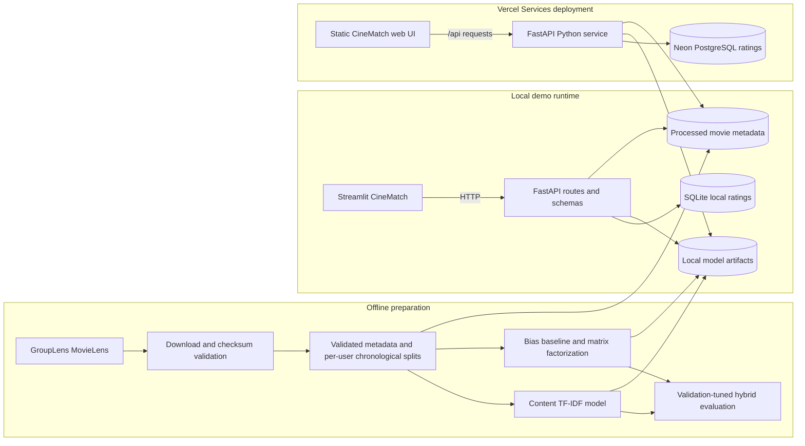

# Architecture

## Request path

The local Streamlit UI calls the FastAPI service through `frontend/api_client.py`.
The hosted browser UI in `frontend/web/` uses the same `/api/*` routes on the
Vercel deployment. Local runs use SQLite; hosted runs use PostgreSQL through
`DATABASE_URL`.
FastAPI validates inputs and serializes responses with Pydantic schemas. Search
reads the processed movie metadata; similarity and personalized rankings use
the fitted artifacts. Locally submitted ratings live in SQLite and contribute
to the user's content profile. The API blends that profile with the trained
collaborative scores and excludes rated items.

The workflow deliberately separates training from serving. The evaluation
script tunes its blend with validation data and then evaluates the chosen
weight on the untouched test split. API recommendations do not read validation
or test files.
