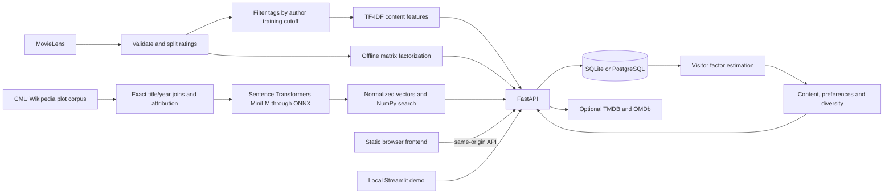

# Architecture

Offline preparation and request serving are separate. The build creates model
artifacts and joined catalog metadata; no dataset download, model download or
full-model training runs in a request. `scripts/prepare_demo.py` records input
fingerprints and rebuilds changed derived artifacts. Visitor ratings are never
used as input to that build or overwritten by it.

The browser obtains a server-issued private profile with a random bearer secret.
Only its hash is stored server-side. The browser uses `X-Profile-Token` to access
its own ratings, watchlist and recommendations. Restoring a recovery code grants
access to the same persisted profile; an ID alone grants no hosted access.
Legacy numeric profiles remain a local Streamlit convenience and are never
mapped to MovieLens user factors or training histories.

The visitor ranker estimates a bias and latent vector through a small regularized
least-squares solve against fixed item factors. Content preferences include
negative signals. The shortlist uses bounded genre diversification and returns
factual reasons. The scorer and frozen validation-selected policy are shared with the visitor
evaluator. Policies are chosen before evaluating a disjoint test cohort. Plot
profiles use stored embeddings without additional encoder inference. Explicit
watched/not-interested states are stored separately and applied as exclusions.

Semantic search covers verified plot matches only. The 384-dimensional vectors
are L2 normalized, and structured filters exclude missing runtime/language
values when those fields are required. Plot metadata is a static corpus, not a
claim about historically available training features. Story-search vectors are
not silently injected into the chronological recommendation benchmark.

Alembic adopts the original ratings table and adds profile, watchlist and feedback
tables without deleting existing rows. PostgreSQL startup migrations use a
transaction-scoped advisory lock. Private API responses are not cacheable, and
feedback write budgets are enforced against persisted events. Anonymous profile
creation requires separate edge controls for deployments needing abuse resistance.

Vercel retains the existing static-web and Python-API services. Hashed runtime
dependencies exclude browser-testing, MLflow, PyTorch and Implicit research tools.
Local Streamlit and Docker are optional interfaces; they do not replace the
browser's private-profile workflow. PostgreSQL credentials remain in Vercel's
server environment; its ephemeral filesystem is not used for ratings.
